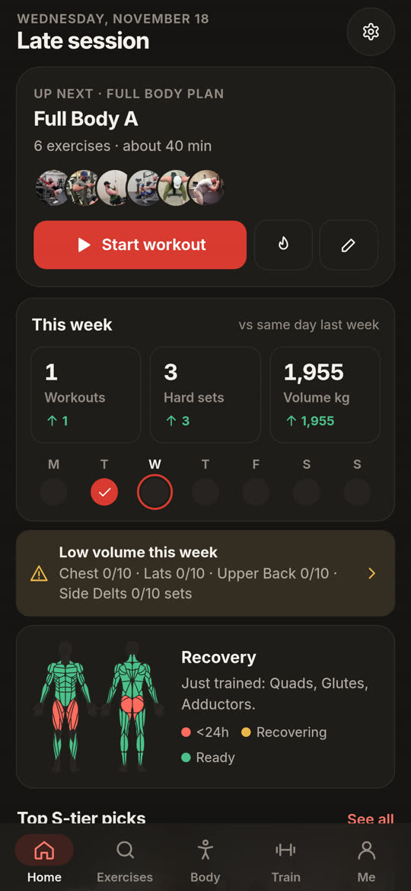
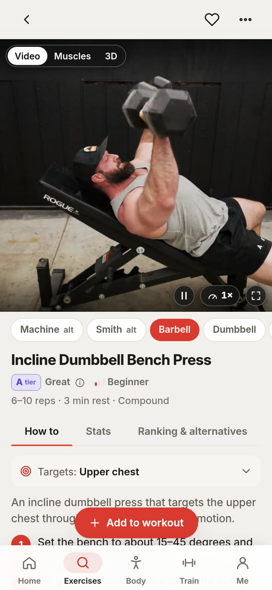
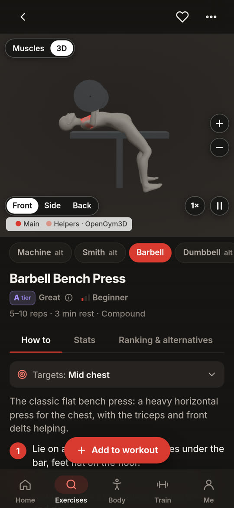
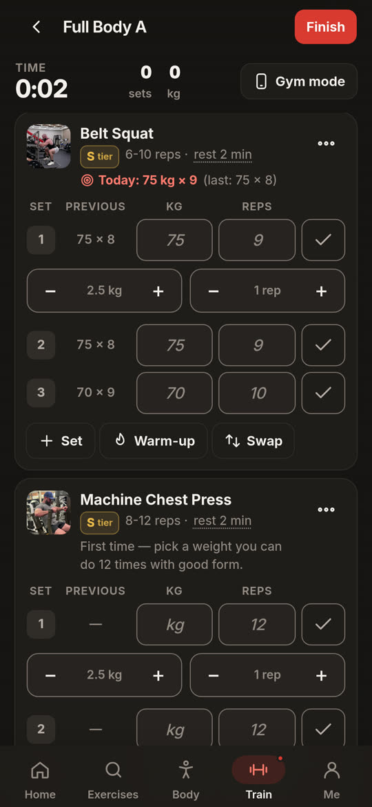
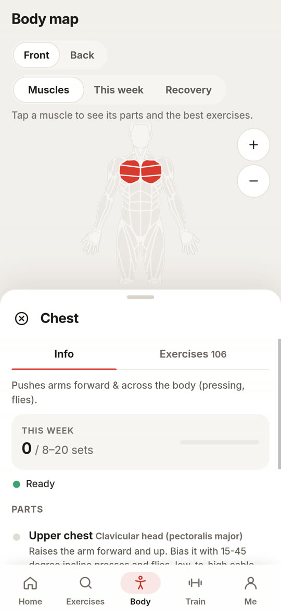
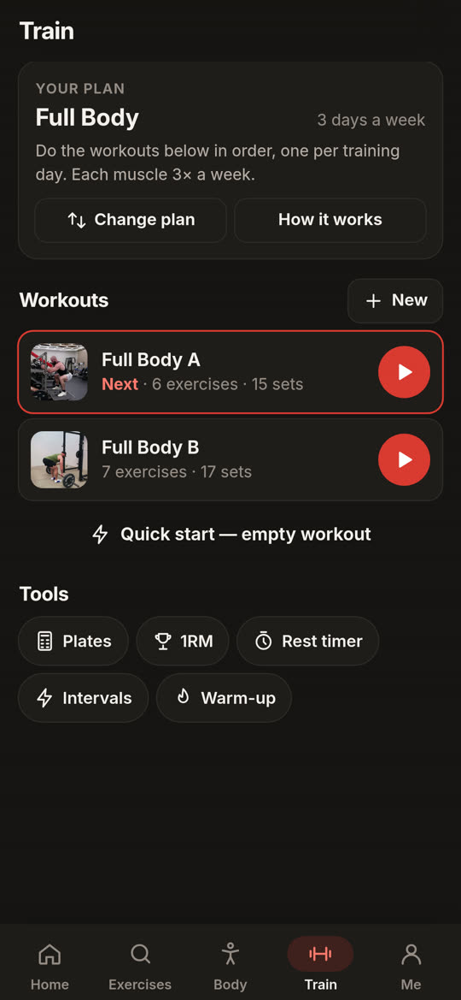

<div align="center">


# Gym

**The best exercises for every muscle, a plan for your level, and a logger that stays out of your way.**
Free. Offline. No account. No ads.

[](https://mohamedattiadev.github.io/gym)


</div>

<br>

<table>
  <tr>
    <td align="center"><br><sub><b>Home</b> · what to do today</sub></td>
    <td align="center"><br><sub><b>Exercise</b> · demo, tier, how-to</sub></td>
    <td align="center"><br><sub><b>3D</b> · see the movement and the muscles</sub></td>
  </tr>
  <tr>
    <td align="center"><br><sub><b>Logger</b> · last time, today's target</sub></td>
    <td align="center"><br><sub><b>Body map</b> · tap a muscle</sub></td>
    <td align="center"><br><sub><b>Your plan</b> · change it any time</sub></td>
  </tr>
</table>

## Why

Big exercise libraries show you hundreds of moves but never tell you which ones are worth your time.
Gym answers that first: every exercise carries **Jeff Nippard's S / A / B / C ranking**, so the best options for a
muscle are always on top. Around that sits everything you need for a session, in one calm app that works without signal.

## What's inside

| | |
| --- | --- |
| **840+ exercises**, 830+ with demo videos, ranked by tier, searchable in English, Turkish and Arabic (typos are fine) | **10 training plans** from 2 to 6 days a week, with one clear *Recommended* pick for your level |
| **3D body** that performs the movement and lights up the working muscles, zoom and rotate | **Common mistakes** shown side by side: wrong vs right, as a 3D loop or video |
| **Body map** with sub-muscles (heads), weekly sets per muscle and recovery colours | **Workout logger**: last session's numbers, today's target, one tap to repeat, plate calculator |
| **Rest timer** on the lock screen with the next set, sound and vibration | **Progress**: personal records, e1RM charts, weekly volume, CSV export and Strong / Hevy import |
| **Warm-ups** built for the workout you are about to do | **Private by design**: data stays on your phone, optional backup to your own GitHub |

## Install

1. Open **[mohamedattiadev.github.io/gym](https://mohamedattiadev.github.io/gym)** on your phone.
2. Tap **Install** on the banner (Android), or **Share → Add to Home Screen** (iPhone).
3. Optional: **Me → Settings → Offline videos** once on Wi-Fi, so demos play in a basement gym too.

## Built with

Plain HTML, CSS and JavaScript modules: no framework, no bundler, no tracking.
IndexedDB for your data, a service worker for offline use, [three.js](https://threejs.org) for the 3D view.
Every release runs one check script (`tools/test/all.sh`): unit tests, a smoke test of every page on phone and
desktop in both themes, and an automatic check of every 3D motion.

<details>
<summary><b>Run it locally</b></summary>

```bash
ln -s ../media app/media                  # once: videos and posters
cd app && python3 -m http.server 8765     # http://localhost:8765
bash tools/test/all.sh                    # all checks (needs Chromium + Node)
bash tools/test/fast.sh                   # quick checks without a browser (CI runs these on every push)
bash tools/bump-sw.sh                     # new service worker VERSION: needed for every change under app/
```

```
app/          the website (GitHub Pages publishes this folder)
  js/ css/ data/ 3d/ sw.js manifest.webmanifest
media/        videos, posters, figures
tools/        data build scripts, 3D tools, tests
```

</details>

## Credits

This is a personal, non-commercial project. It is **not affiliated with, endorsed by, or sponsored by** anyone named
here. If you like it, support the original creators.

| Content | By |
| --- | --- |
| Exercise demo videos, posters and names | **[Get SWOLE](https://getswole.app)** and the coaches in the videos |
| Exercise rankings, training principles, split and volume guidance | **[Jeff Nippard](https://www.youtube.com/@JeffNippard)** |
| Weekly volume and recovery ideas | **[Renaissance Periodization](https://www.youtube.com/@RenaissancePeriodization)** |
| 3D body and base motion clips | **[OpenGym3D](https://github.com/AssiamahS/opengym3d)** (MIT) |
| Body map shapes | **[react-native-body-highlighter](https://github.com/HichamELBSI/react-native-body-highlighter)** (MIT, modified) |
| Muscle figures | **[open-exercise-figures](https://github.com/AbanoubAmir/open-exercise-figures)** (CC0) |

Open-source libraries (three.js, meshoptimizer, the Inter font) keep their licenses next to the code: `app/vendor/three/LICENSE`, `app/3d/LICENSE`, `app/fonts/OFL.txt`.

**Own any of this content and want it changed or removed?** [Open an issue](https://github.com/Mohamedattiadev/gym/issues)
and it will be done right away, no questions asked.

## License

The code written for this app is [MIT](LICENSE). Third-party content (videos, posters, exercise names, rankings and
the works listed above) stays with its owners under their own terms.
